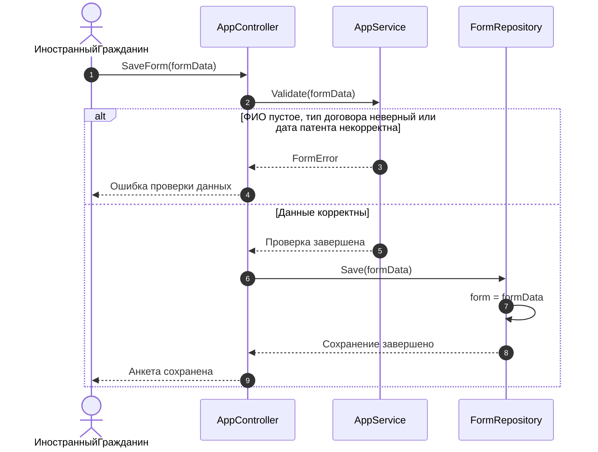
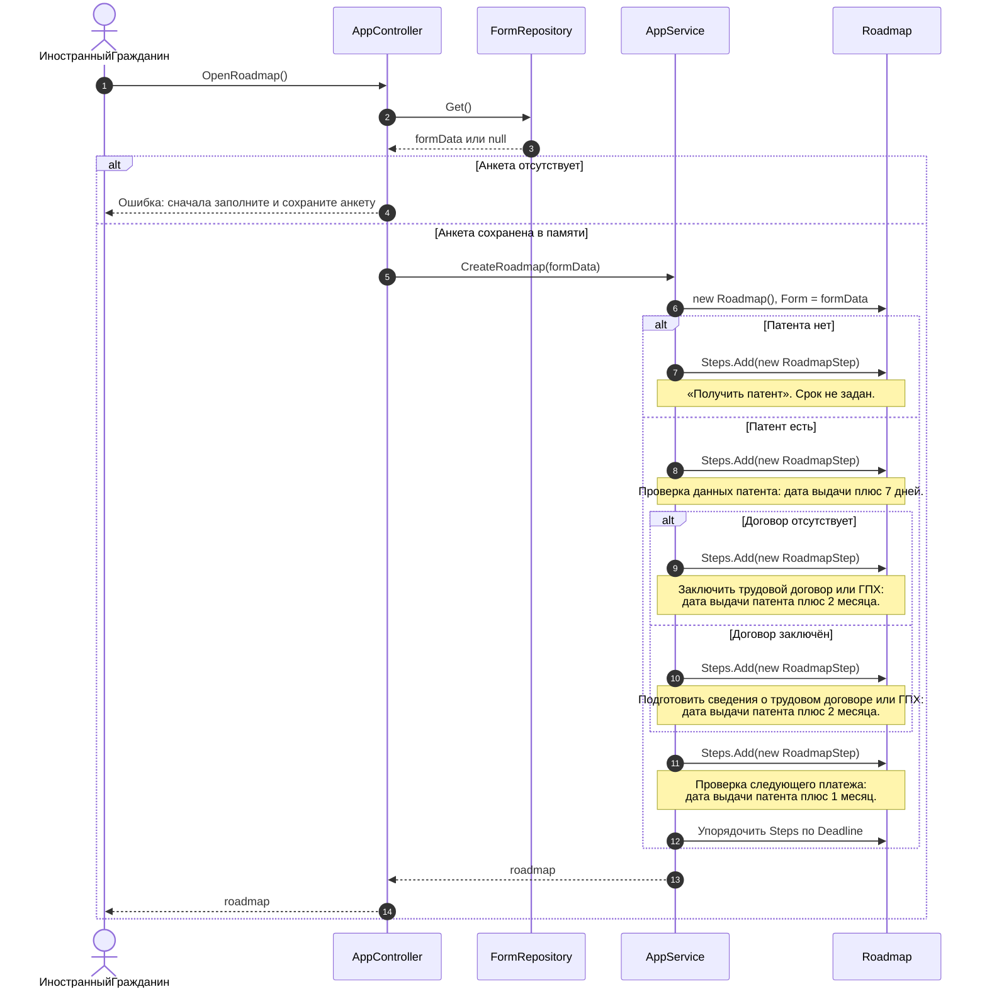

Лабораторная 4
Создание диаграмм последовательностей
С помощью диаграмм отобразить взаимодействие объектов в
системе.
Диаграмма создаётся для каждой системной функции всех
диаграмм последовательностей, из предыдущей лабораторной.

# Диаграмма последовательностей системных функций.

Окна интерфейса опущены. Обращения пользователя к контроллеру и ответы
показаны условно через границу системы; обработка нажатий и показ сообщений
остаются в интерфейсе и здесь не детализируются.

## Ввести данные

## Открыть дорожную карту

