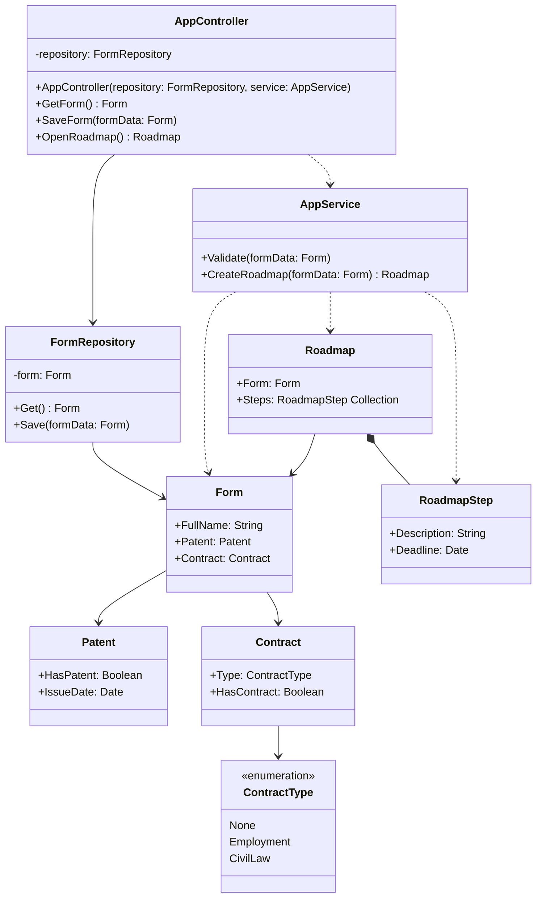

Лабораторная 5
Создание диаграмм классов проектирования
• Диаграмма классов не должна быть привязана к конкретному
языку реализации.
• Диаграмма классов должна быть согласована с диаграммами
коммуникаций.

# Создание диаграмм классов проектирования

