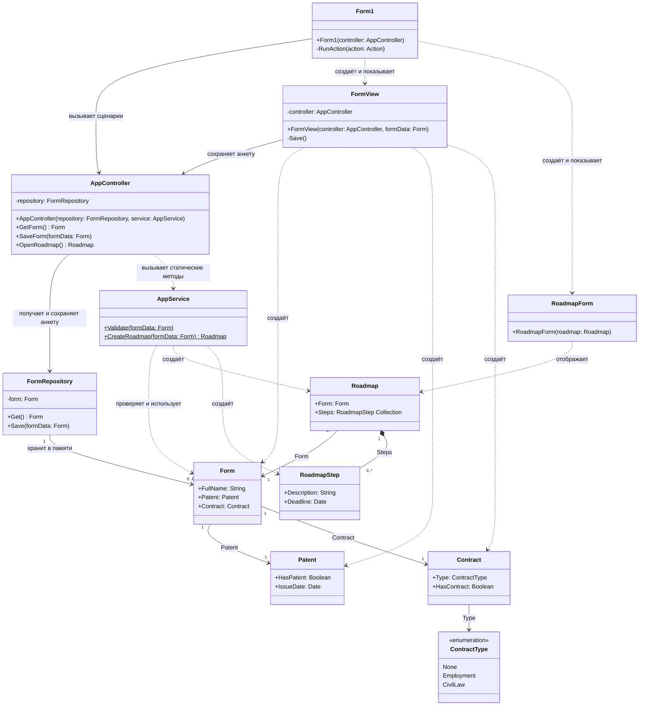

Лабораторная 5
Создание диаграмм классов проектирования
• Диаграмма классов не должна быть привязана к конкретному
языку реализации.
• Диаграмма классов должна быть согласована с диаграммами
коммуникаций.

# Создание диаграмм классов проектирования

Имена классов и операций соответствуют коду. Типы `String`, `Boolean`, `Date`
и `Collection` обозначены независимо от языка реализации. Элементы интерфейса,
вспомогательная раскладка окон и стандартные классы WinForms опущены.

- `Form` — модель анкеты. `FormView`, `Form1` и `RoadmapForm` — окна интерфейса.
- `FormRepository` хранит одну анкету в памяти. До сохранения `Get()` и `GetForm()`
  могут вернуть отсутствие анкеты; после закрытия приложения данные теряются.
- `IssueDate` и `Deadline` могут отсутствовать. `HasContract` вычисляется как
  `Type != None` и не изменяется отдельно.
- Методы `AppService` статические (обозначены `$` в исходнике Mermaid).
  Параметр `service` есть в конструкторе `AppController`, но в текущем коде
  не используется: методы вызываются через имя класса `AppService`.
- Связи `Form` с `Patent` и `Contract` — ссылки на объекты. `Roadmap` ссылается
  на сохранённую анкету и содержит коллекцию шагов. В модели коллекция может
  быть пустой; `CreateRoadmap()` создаёт один шаг без патента или три при его наличии.
